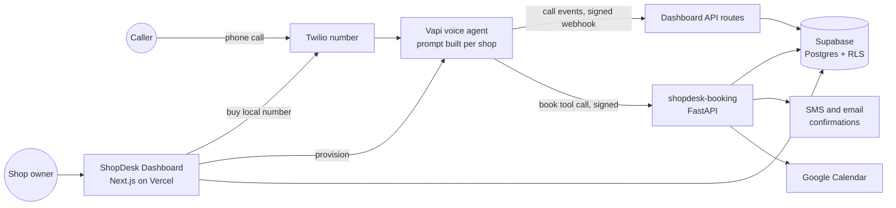
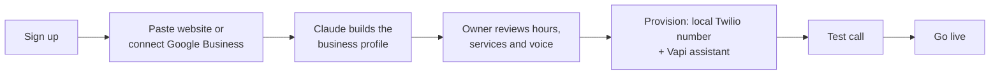

<div align="center">

# ShopDesk

### An AI phone receptionist for local service businesses

ShopDesk answers every call 24/7, answers questions about the business, and books appointments straight onto the owner's calendar, so small shops never miss a customer again.


**This repo: the owner dashboard** · Booking backend: [`shopdesk-booking`](https://github.com/CodeBen98/shopdesk-booking)

</div>

---

## Contents

- [The problem](#the-problem)
- [What ShopDesk does](#what-shopdesk-does)
- [Architecture](#architecture)
- [Onboarding flow](#onboarding-flow)
- [Features](#features)
- [Engineering highlights](#engineering-highlights)
- [Tech stack](#tech-stack)
- [Project structure](#project-structure)
- [Running locally](#running-locally)
- [Testing and CI](#testing-and-ci)

## The problem

Auto shops, HVAC companies, plumbers and salons lose jobs every day to missed calls: the owner is under a car, on a roof, or with a client. Voicemail doesn't convert, and a human answering service is expensive.

## What ShopDesk does

A shop owner signs up, and in a few minutes ShopDesk:

1. **Learns the business** from its website or Google Business Profile (hours, services, prices, tone of voice).
2. **Gives it a local phone number** and an AI receptionist trained on that profile.
3. **Answers calls** like a front-desk employee: answers questions, captures the caller's details, books appointments, and transfers real emergencies to the owner.
4. **Shows everything in a dashboard**: every call and its outcome, bookings, and a customer list.

## Architecture



## Onboarding flow



## Features

| For shop owners | Under the hood |
|---|---|
| Guided setup in a few minutes | Website and Google Business Profile harvesting + Claude synthesis into a Zod-validated profile |
| A local number matching their area code | Twilio number search with geographic fallback |
| A receptionist that sounds like their shop | System prompt generated from the profile, industry template and chosen voice |
| Appointments land on their calendar | Booking tool calls to `shopdesk-booking` → Google Calendar |
| Emergencies reach them right away | Transfer-call rules during business hours |
| Call log, bookings and customers | Supabase tables populated from signed Vapi webhooks |
| Works for their industry | Templates for 10+ verticals (intake questions, urgency triggers, "never claim" rules) |

An **admin panel** handles provisioning, pausing, cancelling and deleting shops, with transactional emails sent through Resend.

## Engineering highlights

- **Security by default.** HMAC-verified webhooks with constant-time comparison; row-level security on every table; the service role is used only on the server; strict CSP, HSTS and frame headers; secrets only in environment variables.
- **Prompt-injection hardening.** All owner-supplied text is length-limited and stripped of injection patterns before it reaches the voice agent's prompt (covered by tests).
- **Structured AI output.** Business-profile synthesis uses Claude with a Zod schema, so malformed model output never reaches the database.
- **Multi-tenant isolation.** Every call, booking and message is scoped to the shop that owns the assistant, with no global fallbacks.
- **Quality gates.** TypeScript strict mode, ESLint, unit tests and a CI pipeline that builds the app on every push.

## Tech stack

| Layer | Technology |
|---|---|
| Web app | Next.js 16 (App Router), React 19, TypeScript, Tailwind CSS 4 |
| Data and auth | Supabase: Postgres, Auth, row-level security, SQL migrations |
| Voice and telephony | Vapi (AI voice agent), Twilio (numbers and SMS) |
| AI | Anthropic Claude (profile synthesis), Zod (structured output) |
| Integrations | Google Business Profile and Google Calendar (OAuth), Firecrawl, Google Places, Resend |
| Quality | ESLint, Vitest, GitHub Actions |
| Hosting | Vercel |

## Project structure

```
src/
├── app/
│   ├── auth/            login, sign-up, password reset
│   ├── onboard/         onboarding wizard
│   ├── dashboard/       calls, bookings, customers, settings
│   ├── admin/           internal admin panel
│   └── api/             provisioning, Vapi webhook, enrichment, Google OAuth, admin actions
├── components/
│   └── onboarding/      one component per wizard step
└── lib/
    ├── shopPrompt.ts    builds the receptionist's system prompt and booking tools
    ├── enrichment/      website and Google Business Profile harvesting + Claude synthesis
    ├── industries/      per-industry templates
    ├── supabase/        browser, server and admin clients
    └── __tests__/       unit tests
supabase/
├── schema.sql           tables and row-level security policies
└── migrations/          incremental migrations
```

## Running locally

**Requirements:** Node.js 20+ and a Supabase project (the free tier is enough).

```bash
git clone https://github.com/CodeBen98/shopdesk-dashboard.git
cd shopdesk-dashboard
npm ci
cp .env.local.example .env.local    # add your own keys
npm run dev                          # → http://localhost:3000
```

Create the database by running `supabase/schema.sql`, then the files in `supabase/migrations/`, in your Supabase project. Voice, telephony and enrichment need their own API keys (listed in `.env.local.example`). Without them, the app still builds and the auth and dashboard pages run.

## Testing and CI

| Command | Purpose |
|---|---|
| `npm run dev` | Development server |
| `npm run build` | Production build |
| `npm run lint` | ESLint |
| `npm run typecheck` | TypeScript |
| `npm test` | Unit tests (Vitest) |

GitHub Actions runs lint, typecheck, tests and a production build on every push and pull request.

---

<div align="center">

Built by **Slarve Benoit** · [@CodeBen98](https://github.com/CodeBen98)

</div>
